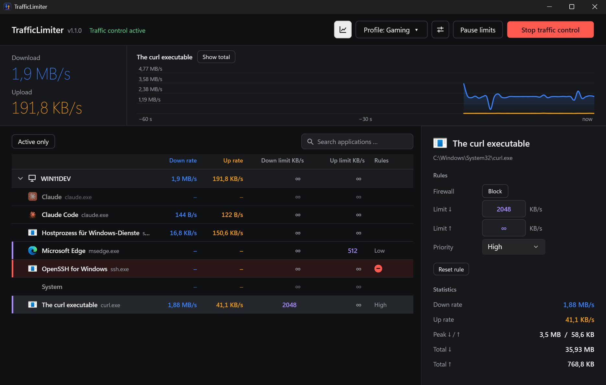
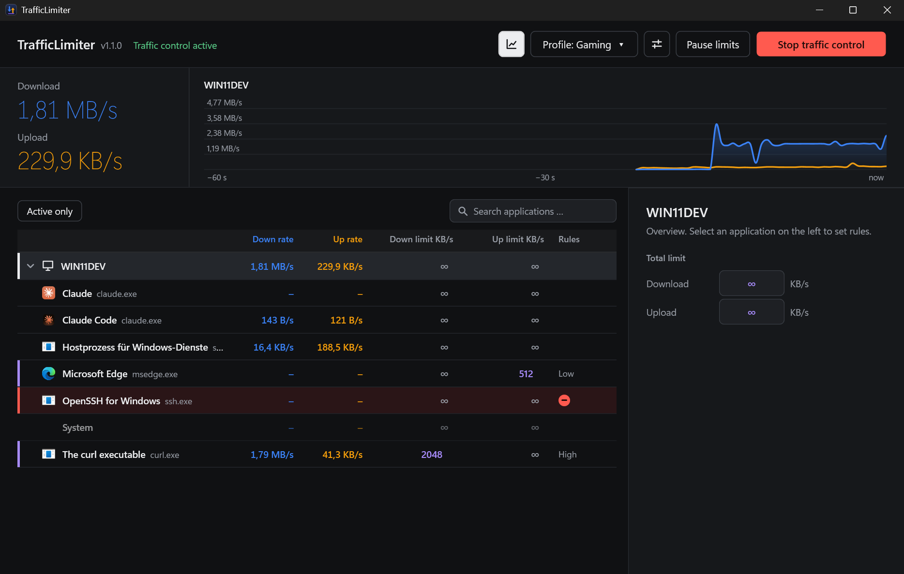
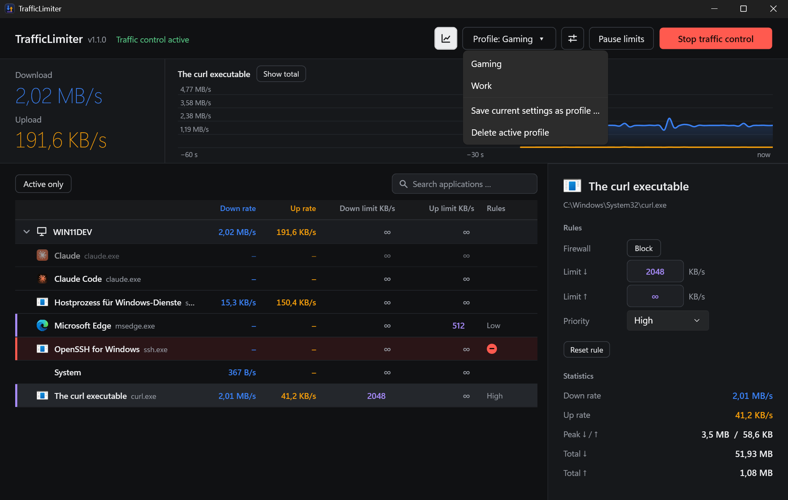
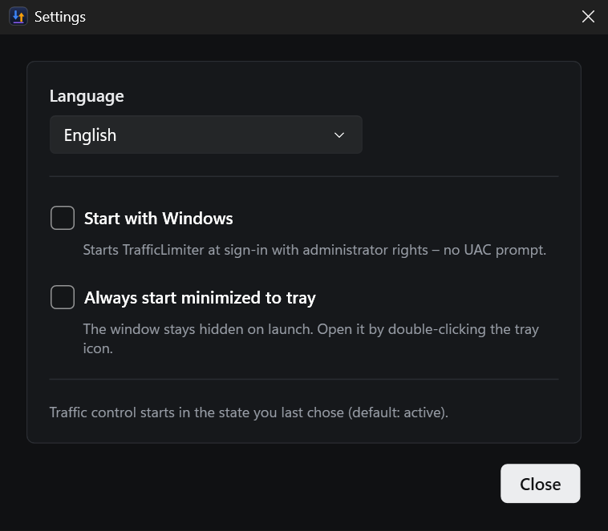

<p align="center">
  
</p>

<h1 align="center">TrafficLimiter</h1>

<p align="center">
  <b>See which apps use your network, cap their speed, or block them completely.</b><br>
  A modern, open-source bandwidth limiter and per-app firewall for Windows, inspired by NetLimiter.
</p>

<p align="center">
  
  
  
</p>

<p align="center">
  
</p>

## What is it?

Windows shows you *that* your connection is busy, but not *who* is using it, and it gives you no way to say
"this program may only use 2 MB/s". TrafficLimiter fills that gap:

- **See** download and upload speed of every program in real time.
- **Limit** the download and/or upload speed of any program, or of the whole computer.
- **Block** a program from the network with one click.
- **Prioritise** programs, so a video call or game wins over a background download.

It is a single `.exe`, needs no installer, and everything you change takes effect immediately.

> The screenshot above is real: a `curl` download is limited to **2048 KB/s** and the chart shows the flat 2 MB/s
> line, Edge has a 512 KB/s upload cap (violet bar), and `ssh` is blocked (red row).

Colour always means the same thing: **blue** is download, **amber** is upload, **violet** is a limit, **red** is a block.
Everything else is neutral graphite (dark) or paper (light).

## Features

| | |
|---|---|
| **Live per-app monitor** | Download/upload rate, totals and peaks per application, with icons and readable names. Idle apps fade into the background, apps with rules stay highlighted. |
| **Speed limits** | Type a limit in KB/s right in the list (press Enter). Separate limits for download and upload, plus a total limit for the whole computer. |
| **Per-app firewall** | Block an application from the network; blocked rows are tinted red. |
| **Priorities** | Low / Normal / High / Critical. With a total limit set, higher priorities get bandwidth first. |
| **Live meter** | The current download and upload in large numerals, next to a smooth 60-second chart of the whole computer or the selected app. Hide the chart with one click. |
| **Profiles** | Save your current rules as a profile (for example *Gaming*, *Work*) and switch with two clicks, also from the tray menu. |
| **Tray quick actions** | Pause all limits, start/stop traffic control, switch profile, open the window. |
| **Start with Windows** | Optional. Uses an elevated scheduled task, so there is no UAC prompt at every login. Can start minimised to the tray. |
| **English and German** | Switch the language live in the settings; the default follows Windows. |
| **Dark and light theme** | Follows the Windows setting. Keyboard-friendly: every control has a visible focus ring. |
| **Search and filter** | Search by name, show only apps that are active right now, collapse the process list. |

## Quick tour

1. Start `TrafficLimiter.exe` and click **Start traffic control**. The app offers to restart with administrator
   rights, because the packet filter needs them. From then on traffic control starts automatically.
2. The list shows your computer on top and all programs with network activity below it.
3. **Limit a program:** click into its *Down limit* or *Up limit* cell, type a value in KB/s, press Enter. Empty or `∞` means unlimited.
4. **Block a program:** select it, then use *Block* in the panel on the right. A red bar appears next to the row.
5. **Limit everything:** select the computer row on top and enter a total limit.
6. **Save a setup:** *Profile ▾ → Save current settings as profile …*

<table>
  <tr>
    <td width="50%" align="center"><br><sub>Overview: the computer row shows totals and holds the total limit</sub></td>
    <td width="50%" align="center"><br><sub>Profiles: switch whole rule sets at once</sub></td>
  </tr>
</table>

<p align="center">
  <br>
  <sub>Settings: language, start with Windows, start minimised to tray</sub>
</p>

## How it works

TrafficLimiter is a normal user-mode app. For packet access it uses [WinDivert](https://github.com/basil00/WinDivert),
a signed packet-interception driver.

1. **Who owns a packet?** WinDivert *flow* events plus the Windows TCP/UDP connection tables map every
   (protocol, local port) to a process. Existing connections are picked up when traffic control starts.
2. **Capture:** TCP and UDP packets (IPv4 and IPv6, loopback excluded) are intercepted on the network layer,
   counted per application, and re-injected.
3. **Limits:** every limited app and direction has a *token bucket*. Packets that exceed the rate are delayed in
   a queue and released on time, so TCP slows itself down without any packet loss. If a packet would have to wait
   longer than one second (or the queue is full), it is dropped, which is also how UDP/QUIC traffic is throttled.
4. **Block:** packets of blocked apps are simply dropped.
5. **Priorities:** a shared bucket for the total limit keeps a reserve for higher priorities, so lower ones wait first.
6. **Safe by design:** the packet loop runs on dedicated threads, never on the UI thread. Stopping traffic control or
   closing the app releases the driver handles, and traffic flows normally again immediately.

## Requirements

- Windows 10 or 11, 64-bit.
- Administrator rights (the packet filter needs them).
- To build from source: the [.NET 10 SDK](https://dotnet.microsoft.com/download).

## Build from source

```powershell
git clone https://github.com/Kurosaki22/TrafficLimiter.git
cd TrafficLimiter

dotnet build
dotnet test

# One self-contained file (~72 MB, nothing else needs to be installed):
dotnet publish TrafficLimiter.App -p:PublishProfile=SingleFile        # -> publish\TrafficLimiter.exe

# Tiny file (~0.6 MB) that uses the installed .NET 10 Desktop Runtime:
dotnet publish TrafficLimiter.App -p:PublishProfile=SingleFileSmall   # -> publish-small\TrafficLimiter.exe
```

The WinDivert driver (`WinDivert.dll`, `WinDivert64.sys`) is embedded in the executable. On first start it is extracted to
`%LocalAppData%\TrafficLimiter\native`. Settings and profiles are stored in `%AppData%\TrafficLimiter\settings.json`.

## Good to know

- **Limits are per executable.** All processes of one program share its rule, and so do all Windows services hosted in
  `svchost.exe`.
- **Scope:** TCP and UDP over IPv4/IPv6. IPv6 packets with extension headers and loopback traffic pass through untouched.
- **Shaping is approximate** (token bucket with a short delay queue), good for "about 2 MB/s", not for exact accounting.
- **Antivirus warnings:** packet-capture drivers are sometimes flagged by heuristics. The two WinDivert files are the
  unmodified official release 2.2.2; see [THIRD-PARTY-NOTICES.md](THIRD-PARTY-NOTICES.md).
- **SmartScreen:** the executable is not code-signed, so Windows may show a warning on first run.
- **Names follow your Windows language**, because they come from the program's file description.
- Blocking or limiting important system processes can break parts of Windows (for example network drives). Use with care.

## Project layout

| Path | What |
|---|---|
| `TrafficLimiter.Core` | Packet engine (WinDivert, token buckets, process mapping), rules and settings storage |
| `TrafficLimiter.App` | WPF user interface (MVVM), themes, localisation, tray |
| `TrafficLimiter.Tests` | Unit tests (token bucket, settings and profile storage) |
| `tools/make-icon.ps1` | Generates the app icon (`app.ico`, `assets/icon.png`) |
| `tools/capture-screenshots.ps1` | Re-creates the screenshots above with demo rules |

## Ideas for later

Per-app connection list (remote address, port) · prompt when a new app wants network access · long-term statistics and quotas ·
scheduled rules · split `svchost.exe` by Windows service · global hotkeys · installer.

## License

[MIT](LICENSE). WinDivert is used under the LGPL v3 / GPL v2, see [THIRD-PARTY-NOTICES.md](THIRD-PARTY-NOTICES.md).

TrafficLimiter is an independent project. It is inspired by NetLimiter but is not affiliated with or endorsed by
Locktime Software. Use at your own risk: a tool that can cut off network access can also cut off yours.
